# SysDeck · 服务器控制面板

[](https://github.com/hb-degithub/sysdeck/actions/workflows/ci.yml)
[](LICENSE)

单机服务器监控与管理面板，零 npm 依赖，Node.js 原生实现。可安装为 PWA，并已打包成 Android App。

## 特性

- **实时监控**：CPU（总/分核/温度/频率/降频）、内存、Swap、负载、磁盘 IO、网络、PSI 压力
- **GPU / 显存**：显存 VRAM 用量与占比、GTT 共享显存、GPU 占用率、温度、功耗、核心/显存频率、电压
- **CPU 详情**：每核心占用率 + 用户/系统/IO等待/空闲拆分 + 每核实时频率 + 降频判定
- **磁盘详情**：NVMe 与机械盘统一展示，型号、序列号、固件、分区、挂载点、调度器、块大小
- **SMART 健康**：健康自检、温度、通电时长、重映射/待映射/不可校正扇区、CRC 错误、启停次数；
  NVMe 额外显示寿命已用、可用备用、累计写入、媒体错误、异常断电
- **历史回看**：SQLite 落库，1h / 6h / 24h / 7d，自动降采样
- **进程 / 服务 / 日志**：全量进程列表、systemd 服务状态、journalctl 日志
- **连接与端口**：TCP/UDP 连接表、监听端口、协议栈统计（重传率等）
- **定时任务**：cron 任务、systemd timer、周期性任务目录
- **传感器**：温度 / 功耗 / 电压 / 风扇全量读取
- **系统详情**：inode、虚拟内存、磁盘调度器、内核模块、软件包、PCI 设备、时间同步
- **Docker 管理**：容器启停/重启/删除、进入容器 shell、日志与资源统计、Compose 项目启停、镜像/网络/卷/磁盘占用
- **性能压测**：CPU 多线程（温度/降频/GPU 观测、温度墙）、内存带宽与延迟、磁盘顺序/随机、网络 loopback 吞吐；结果入库可历史对比
- **文件管理**：全盘浏览、上传、下载、在线编辑、新建/重命名/改权限、压缩解压；多选批量移动/复制/删除 + 回收站（7 天）
- **文件下载器**：任意文件生成限时/一次性分享链接 + 二维码，手机扫码直接下载；App 内下载走系统下载器
- **告警引擎**：阈值规则（CPU/内存/磁盘/温度/负载/网络，持续时长 + 滞回 + 冷却去重），触发/恢复写库并推送
- **通知渠道**：企业微信/钉钉/飞书 webhook、SMTP 邮件、ntfy（密钥不落日志/接口）
- **审计 / 会话 / 备份**：审计日志检索分页、登录设备列表与踢下线、配置+数据库一键备份/恢复（自动保留 7 份）
- **特权运维（可选 helper）**：服务启停/自启、结束进程、编辑 crontab、重启/关机、磁盘挂载、ufw 防火墙、apt 更新
  —— 通过独立 root 守护进程 + HMAC 白名单接口实现，面板本身仍以普通用户运行
- **Web 终端**：真实 PTY + 网格 VT 渲染（光标定位/备用屏/256 色/真彩/方向键/功能键），支持 vim/top 等基础全屏程序
- **主题切换**：深色 / 浅色，跟随本地存储
- **移动端适配**：抽屉式侧栏，手机可直接访问
- **PWA 可安装**：manifest + Service Worker，HTTPS 下可「添加到主屏幕」，离线可开壳
- **Android App**：`dist/server-panel-app-1.4.1.apk`（约 2.1 MB 原生 WebView 壳，含多服务器/自动更新/生物识别/小组件/告警通知/DSH 缩放）
- **记住我（30 天免登录）**：登录页勾选后签发 HttpOnly 记住令牌（服务端只存 SHA-256 摘要），重启面板仍可直接进入；可在设置页「忘记本设备」
- **DSH 远程控制**：手机上看 DSH 状态、会话列表、启动/继续 headless 任务（SSE 实时输出）、一键打开 DSH 控制台
- **零依赖**：只用 Node 22 内置模块（`http`、`node:sqlite`、`crypto`、`worker_threads`）
- **开源友好**：无个人路径/IP 硬编码，`config.example.json` + 环境变量驱动，GPL-3.0

## 适配范围与通用性

面板按「拿到什么显示什么」设计，不针对某台机器写死：

| 项目 | 支持情况 |
|---|---|
| CPU | 任意 Linux；物理核/线程/超线程自动识别（`sysfs topology` → `/proc/cpuinfo` → siblings → 回退），识别不到物理核时标注「推算/未知」，不会把线程数当核数 |
| GPU | 按 PCI vendor 识别：AMD（`gpu_busy_percent`/hwmon）、Intel、NVIDIA（`/proc/driver/nvidia`）/ virtio 等；不支持的字段显示为「未检测到」并隐藏卡片 |
| 传感器 | 通用扫描 `/sys/class/hwmon/*`，按设备真实路径归类到 CPU/GPU/SSD，不依赖芯片名 |
| 磁盘 | SATA/NVMe/USB 均可；SMART 需要 `smartmontools` + 白名单包装器（可选） |
| 网络 | `/proc/net/dev`、`/sys/class/net/*/speed`；无线/虚拟网卡照常显示 |
| 容器 | Docker Engine API（socket 可读即可）；未安装时自动降级并显示安装引导 |
| DSH | 可选集成：检测到 `dsh` 时提供控制台/会话/远程任务/聊天；没有则相关入口隐藏 |

> 本文档用 `<面板IP>`、`<项目目录>`、`<tailnet主机名>` 等占位符，按你的部署替换即可。

## 快速开始

```bash
cd <项目目录>
node server.js
```

首次启动会生成 `config.json` 并在控制台打印一次随机密码：

```
============================================================
  首次启动，已生成配置文件：config.json

  用户名：admin
  密  码：xxxxxxxxxxxxxxxx

  请立即登录并修改密码。此密码只显示这一次。
============================================================
```

浏览器打开 `http://<面板IP>:3081`。

## 登录与「记住我」

登录页有「记住我（30 天免登录）」复选框（默认勾选）：

- 勾选后服务端签发一次性记住令牌，浏览器只保存 `HttpOnly + SameSite=Strict` 的 `panel_remember` cookie，
  服务端 `data/remember.json`（0600）里只存它的 **SHA-256 摘要**，不存明文、不存密码
- 下次打开面板（面板重启也不影响）自动登录直接进主界面，不需要再输密码
- 自动登录会轮换令牌（旧令牌立即失效），有效期从登录当天起算 30 天，不滑动续期
- 设置 →「登录与安全」可以看当前设备记住状态、「忘记本设备登录」（下次需输密码）、退出登录
- 忘记面板密码无法找回（只存 scrypt 哈希）：用 `node tests/reset-password.cjs --random` 重置后
  `kill` 面板主进程让它自动重启即可

配置项（`config.json`，可选）：`session.rememberDays`（默认 30，`0` 关闭）、`session.rememberMax`（默认 50，令牌上限）。


## Android App

已打包好的安装包：`dist/server-panel-app-1.4.1.apk`（2.1 MB，已签名，minSdk 26 / targetSdk 35）。

```bash
adb install -r dist/server-panel-app-1.4.1.apk     # 有 adb 时；同签名可覆盖安装旧版本
# 或把 APK 传到手机，用文件管理器点击安装（需允许「安装未知来源应用」）
```

首次打开进入设置页，可选预设地址或自定义：

| 场景 | 地址 |
|---|---|
| 局域网 | `http://<面板IP>:3081` |
| Tailnet（手机开 Tailscale） | `http://<Tailnet IP>:3081` |
| 自定义 | 任意面板地址，如 HTTPS 反代地址 |

App 功能：面板全部页面（WebView）、底部工具条（刷新 / 后退 / 面板 / DSH / 设置）、
文件上传与下载、返回键后退、加载失败重试、DSH 一键打开（自动带登录 token）、
登录 Cookie 持久化（配合「30 天免登录」）、设置页「清除登录状态」（登录异常时自救）、
底栏「下载」入口（打开面板的二维码下载页，点下载走系统下载器保存到 `Downloads/`）、
DSH 控制台显示缩放（设置页/长按 DSH 按钮/页面内浮动按钮，70–150% 可调，双指缩放）。

### DSH 会话目录 / 历史 / 能力

面板和 App 都能浏览真实的 DSH 会话（`$DSH_HOME/sessions/**/session.v4.jsonl.zstd`）：

| 能力 | 说明 |
|---|---|
| 会话目录 | 列出全部会话：标题、工作目录（workspace 分组）、模型、消息数、大小、最后一条摘要 |
| 历史 | 多帧 zstd 用系统 `zstd -dc` 解码，映射 user / assistant / tool（工具调用含参数与结果） |
| 可续聊 | `resumable=true` 的会话可以在面板里继续对话（面板建的无 agent preset 会话） |
| Web 会话 | DSH Web 建的会话带 `agentPreset`，headless 一次性 runner **无法续聊**，只能浏览历史并用「在 DSH 控制台打开」继续 |
| 能力 | `/api/dsh/capabilities` 列出 headless profile 的插件、默认模型、可选 `provider:model`、`dsh.taskPatches`、`historyDecode` |
| 选择 | 新建聊天可指定工作目录（cwd，决定会落在哪个 workspace）与模型（需在 headless providers 内） |

相关接口：

```
GET  /api/dsh/sessions?limit=50&q=&workspace=      # 会话目录
GET  /api/dsh/sessions/:id/messages?limit=200      # 历史消息
GET  /api/dsh/capabilities                         # 插件 / 模型 / 解码能力
POST /api/dsh/chat/sessions {title?, cwd?, dshSessionId?}
POST /api/dsh/chat/sessions/:id/messages {text, model?}
```

> **为什么有些会话不能续聊**：DSH Web 创建的会话绑定了 agent preset（组合了浏览器侧插件），
> headless one-shot runner 拒绝 adopt（`runs under agent preset …, which the one-shot runner does not compose`）。
> 面板据此标记 `resumable=false` 并给出控制台入口，不做「假续聊」。
>
> 要让面板聊天用上更多插件/模型：把它们写进 `dsh.patch` 或 `dsh.taskPatches` 指向的 YAML
> （模板见 `config/dsh-headless.patch.example.yml`），能力面板会读取 `dsh --dump-config` 展示实际生效清单。

### SDK 高级续聊（Web 会话也能续）

DSH Web 创建的会话带 `agentPreset`，headless 一次性 runner **不能**续（组合在启动时固定，
强行 adopt 会丢工具/提示词）。面板提供可选的 **SDK 通道**：用 `dsh --profile sdk`（Host 级、
JSON-RPC over stdio）按会话重组 preset 后 `session/resume`，事件流实时转发。

```json
{ "dsh": { "allowSdkResume": true } }
```

- 开启后：DSH 页的「Web 会话」行多出「继续（SDK）」、历史弹窗多出「继续对话（SDK 通道）」；
  App 的会话详情同样出现该按钮
- 通道选择：`auto`（有 preset → SDK，否则 headless）/ `headless` / `sdk`
- 依赖：`dsh --profile sdk` 可用、preset patch 可探测（`<runtime>/node_modules/@deepseek-ai/dsh-web-app/presets/*.patch.yml`，
  可用 `dsh.sdkPresetPatches` 覆盖）、provider 由 `dsh.patch`/`dsh.sdkProvidersPatch` 提供
- 已知限制：会话正被 `dsh web` 打开时会被写句柄占用 → 返回 `dsh_session_busy_in_web`，
  需先在 Web 端关闭该会话；每轮独立子进程（~0.3–1s 启动，单并发）

### 原生聊天（1.4.0）

App 底栏「聊天」是**原生页面**，不加载 DSH Web UI：

- 会话列表：新建 / 切换 / 删除；历史存在服务端 `data/dsh-chat.json`（0600）
- 发送消息后流式显示状态（思考中 → 阶段 → 完成/失败），最终回答落库，重进可看到历史
- 续聊：首条消息确定 DSH 会话后，后续消息自动 `--session-id` 继续同一会话
- 依赖服务端 `dsh.allowTask=true`；未开启时聊天页提示「服务端未开启 dsh.allowTask」
- 后端接口：`/api/dsh/chat/sessions`（GET/POST）、`/api/dsh/chat/sessions/:id`（GET/DELETE）、
  `/api/dsh/chat/sessions/:id/messages`（POST），事件流沿用 `/api/dsh/task/stream?id=`

重新构建（工具链用户态安装，不需要 root）：

```bash
bash scripts/setup-android.sh     # 一次性：Temurin JDK17 + Android SDK + Gradle 8.9 → ~/.cache/server-panel-android
bash scripts/build-android.sh     # 增量构建，约 10s；--clean 全量
```

签名材料：`android/keystore/release.keystore`（gitignored）+ `~/.config/server-panel/android-signing.txt`（600）。
细节（构建、签名、卸载、FAQ）见 [android/README.md](android/README.md)。

## 把 APK 发到外网（不在同一局域网）

三种方式，按需选：

| 方式 | 命令 | 地址 | 说明 |
|---|---|---|---|
| 本机分发服务（常驻） | `systemctl status server-panel-apk-share` | `http://<面板IP>:3082/` | systemd 服务，开机自启；页面带二维码，APK 放 `dist/` 即自动取最新 |
| Tailscale Funnel（公网 HTTPS） | `sudo tailscale funnel --bg --https=8443 http://127.0.0.1:3082` | `https://<tailnet名>:8443/` | 需要 tailscale 控制面在线；关闭：`sudo tailscale funnel --https=8443 off` |
| 公网临时直链 | `node scripts/publish-apk.js [72h]` | 输出 `https://litter.catbox.moe/xxx.apk` | 匿名文件床，最长 72h；链接公开，任何人可下载 |

- `scripts/apk-share.js`：零依赖分发服务（`/`、`/qr.png`、`/app.apk`），二维码 PNG 由 `lib/qr-png.js` 用
  vendored `qrcode.js` + 手写 PNG 编码生成，会根据访问 Host 自动生成局域网或 HTTPS 链接
- `scripts/publish-apk.js`：上传最新 APK、回读校验 sha256、同时在 `dist/` 生成 `public-apk-<版本>.png` 二维码
- 安装分发服务（一次）：
  ```bash
  sudo tee /etc/systemd/system/server-panel-apk-share.service >/dev/null <<'EOF'
  [Unit]
  Description=Server Panel APK share
  After=network.target
  [Service]
  Type=simple
  User=<运行用户>
  Group=hb
  WorkingDirectory=<项目目录>
  ExecStart=/usr/bin/node <项目目录>/scripts/apk-share.js 3082
  Restart=on-failure
  [Install]
  WantedBy=multi-user.target
  EOF
  sudo systemctl daemon-reload && sudo systemctl enable --now server-panel-apk-share
  ```

## PWA 安装

面板自带 `manifest.webmanifest` 与 Service Worker，支持「添加到主屏幕」并离线打开 App Shell。

浏览器要求安全上下文（HTTPS 或 localhost），所以局域网 `http://<面板IP>:3081` 不会出现安装入口。
启用 HTTPS 最省事的办法是 tailscale（一次 root 操作）：

```bash
sudo tailscale serve --bg --https=8443 http://127.0.0.1:3081
# 之后手机/电脑访问 https://<tailnet主机名>:8443 → 浏览器菜单「安装应用/添加到主屏幕」
```

也可以让面板自己跑 HTTPS（自备证书），在 `config.json` 加：

```json
{ "tls": { "cert": "/path/fullchain.pem", "key": "/path/privkey.pem", "port": 3443 } }
```

## DSH 远程控制

面板新增「DSH 控制」页，把同机的 `dsh web` 串起来：

| 能力 | 说明 |
|---|---|
| 状态 | DSH 进程 / Web 地址 / profile / PID / 运行时长 / token 是否找到 |
| 打开控制台 | 服务端从 `journalctl` 读取最新一次性 token，按访问方 host 改写后返回带 token URL：
  局域网 → `http://<面板IP>:3080/?token=…`；tailnet/外网 → `https://<tailnet主机名>/?token=…`
  （未配置 `dsh.publicUrl` 时自动读取本机 `tailscale status` 的 DNSName，绝不生成 `https://<裸 IP>`） |
| 会话列表 | 扫描 `$DSH_HOME/sessions`，显示最近 20 个（目录 / 时间 / 大小），可「继续」 |
| 远程任务 | 以 `dsh --profile headless --json` 新建或继续会话，SSE 实时输出，单并发 + 超时 + 审计 |

接口（均需登录，任务提交另需 CSRF）：

```
GET  /api/app/info            # 免登录，App 版本与能力
GET  /api/dsh/status
GET  /api/dsh/console-url     # { url, mode: lan|public|custom }
GET  /api/dsh/sessions?limit=20
POST /api/dsh/task            # { prompt, sessionId? } → { id }
GET  /api/dsh/task/stream?id= # SSE
```

配置（`config.json`，均可省略走默认）：

```json
{
  "dsh": {
    "home": "",
    "bin": "",
    "allowTask": false,
    "taskTimeoutMs": 300000,
    "lanHost": "",
    "publicUrl": "",
    "consoleUrlCustom": "",
    "patch": "",
    "credentialsFile": "",
    "env": {}
  }
}
```

> **headless 任务为什么需要 patch + credentials**：自动初始化的 headless profile 可能没有你的
> 自定义 provider。把 provider 配置写进一个 patch YAML（模板见
> `config/dsh-headless.patch.example.yml`），在 `dsh.patch` 指向它；面板启动任务时再把
> `credentialsFile`（默认 `<DSH_HOME>/.credentials.yaml`）里 `refs:` 的键值注入子进程环境
> （密钥不落库、不进日志/接口）。改了 DSH 的模型设置后需同步这个 patch 文件。
> 本机实例的补丁文件是 `config/dsh-headless.patch.yml`（含个人 provider，已加入 `.gitignore`）。
>
> `allowTask` 默认 `false`；开启后登录用户可让 DSH 以 `<运行用户>` 身份执行任意 prompt。
> 这与面板现有的 Web 终端 / 文件管理是同级别权限，请只在可信网络使用。
> 契约细节见 [docs/app-contract.md](docs/app-contract.md)。


## 环境要求

- Linux（读 `/proc`、`/sys`）
- Node.js >= 22.0.0（需要内置 `node:sqlite`）
- 无需 root 即可运行（监控/压测/文件/终端等）；服务启停、防火墙、挂载等特权功能可选安装 `panel-helper`
- 可选：Docker（socket 可读）、`smartmontools`（SMART）、`dsh`（DSH 集成）

## 目录结构

```
├── server.js              # HTTP 服务、路由、SSE 推送、DSH/PWA 接口、可选 TLS
├── package.json
├── config.json            # 配置（含密码哈希，不进 git）
├── config.example.json    # 配置示例（开源用，无个人路径/IP）
├── config/
│   └── dsh-headless.patch.yml  # headless 任务的模型路由补丁（无密钥）
├── scripts/
│   ├── setup-android.sh   # 用户态安装 JDK17 + Android SDK + Gradle（无需 root）
│   └── build-android.sh   # 一条命令产出签名 APK
├── android/               # 原生 Java WebView 壳工程（Gradle，零 npm）
├── dist/                  # APK 产物（不进 git）
├── lib/
│   ├── config.js          # 配置加载、scrypt 密码哈希
│   ├── auth.js            # 登录、会话、CSRF、失败锁定
│   ├── collector.js       # /proc /sys 采集器（零外部命令）
│   ├── store.js           # SQLite 存储与降采样
│   ├── procs.js           # 进程 / 服务 / 日志
│   ├── extra.js           # 连接/端口/定时任务/模块/软件包/传感器/PCI
│   ├── docker.js          # Docker Engine API 客户端
│   ├── smart.js           # SMART 健康度（经白名单包装器）
│   ├── bench.js           # 性能压测引擎（CPU/内存/磁盘）
│   ├── files.js           # 文件管理
│   ├── terminal.js        # PTY Web 终端（Unix Socket）
│   ├── share.js           # 文件下载器：分享令牌、Range、二维码 SVG
│   ├── alerts.js          # 告警引擎（规则求值/滞回/冷却）
│   ├── notify.js          # 通知渠道（webhook/邮件/ntfy）
│   ├── auditlog.js        # 审计日志解析
│   ├── backup.js          # tar.gz 备份/恢复
│   ├── appUpdate.js       # App 版本扫描（/api/app/update）
│   ├── chat.js            # App 原生聊天存储与调度
│   ├── dshSessions.js     # DSH 会话目录/历史解码/能力解析
│   └── vendor/            # 内联第三方源码（qrcode-generator，MIT）
│   ├── vendor/            # 内联第三方源码（qrcode-generator，MIT）
│   └── dsh.js             # DSH 集成：状态/token/会话/headless 任务
├── public/
│   ├── index.html
│   ├── app.js             # 路由与页面渲染（含 DSH 控制页）
│   ├── charts.js          # Canvas 图表库
│   ├── style.css
│   ├── manifest.webmanifest
│   ├── sw.js              # Service Worker（App Shell 离线）
│   └── icons/             # PWA / App 图标
├── data/
│   └── metrics.db         # 历史数据（不进 git）
├── docs/
│   ├── app-contract.md    # App 集成契约（后端/前端/Android 三方接口）
│   └── shots/             # 界面截图
└── tests/                 # 回归测试套件
```

## 配置

`config.json` 首次启动自动生成，权限 `0600`。完整示例见 [config.example.json](config.example.json)（空字符串=自动推导）。

| 字段 | 说明 |
|---|---|
| `port` | 监听端口，默认 3081 |
| `host` | 监听地址，默认 `0.0.0.0` |
| `panel.username` | 登录用户名 |
| `panel.passwordHash` | scrypt 哈希，勿手改 |
| `sampleIntervalMs` | 采样间隔，默认 1000 |
| `retention.archiveDays` | 历史保留天数，默认 30 |
| `thresholds` | 告警阈值（CPU/内存/磁盘/温度） |
| `session.rememberDays` | 「记住我」免登录天数，默认 30，`0` 关闭 |
| `session.rememberMax` | 记住令牌上限，默认 50（超出淘汰最旧） |
| `dsh` | DSH 集成：`home` / `bin` / `allowTask` / `taskTimeoutMs` / `lanHost` / `publicUrl` / `consoleUrlCustom` / `patch` / `credentialsFile` / `env` |
| `tls` | 可选 HTTPS：`cert` / `key` / `port`（默认 3443，证书缺失只告警） |
| `alerts` | 告警：`enabled` / `cooldownMinutes`(10) / `notifyOnRecover` / `rules[]`（默认 5 条） |
| `notify` | 通知：`webhook{enabled,type,url}` / `email{...}` / `ntfy{enabled,url,topic}` |
| `backup` | 自动备份：`auto`(true) / `keep`(7) / `hour`(4) |
| `appUpdate` | App 更新：`distDir`（默认 `<repo>/dist`） |
| `helper` | 特权助手：`enabled` / `socketPath` / `secretFile` / `timeoutMs`（未安装时相关接口返回 503） |
| `dsh.allowSdkResume` | 开启 SDK 高级续聊（默认 false）；另见 `sdkProfile` / `sdkPresetPatches` / `sdkProvidersPatch` / `sdkTimeoutMs` |
| `fileManager.trashRetentionDays` | 回收站保留天数，默认 7 |
| `download` | 下载器：`shareTtlMinutes`（默认 60）/ `maxShares`（默认 100）/ `maxHits`（默认 0 不限） |

环境变量可覆盖：`PANEL_PORT`、`PANEL_HOST`。

## 部署

### 临时运行

```bash
setsid node server.js > /tmp/panel.log 2>&1 < /dev/null &
```

### 开机自启 + 守护（已配置）

面板以 **systemd 系统服务**运行（`/etc/systemd/system/server-panel.service`），**当前已启用**：

```bash
sudo systemctl status server-panel     # 查看状态
sudo systemctl restart server-panel    # 重启
sudo systemctl stop server-panel       # 停止
sudo journalctl -u server-panel -f     # 实时日志
```

服务特性：
- `Restart=always` + `RestartSec=3`：进程崩溃 3 秒内自动拉起（已实测 kill -9 后自动恢复）
- `User=<运行用户>` + `SupplementaryGroups=docker`：以普通用户运行，但显式继承 `docker` 组，
  因此能访问 `/var/run/docker.sock` 而不需要 root
- 开机即启动，不依赖用户登录（`WantedBy=multi-user.target`）
- 日志：`journalctl -u server-panel`，另写入 `data/panel.out.log` / `data/panel.err.log`

> **改了代码或 config.json 之后必须重启服务才生效**（Node 不会热加载）：
> `sudo systemctl restart server-panel`。
> 验证：`curl -s http://127.0.0.1:3081/api/app/info` 能返回 JSON 即新版本已上线。

手动重建服务配置：

```bash
mkdir -p ~/.config/systemd/user
cat > ~/.config/systemd/user/server-panel.service <<'EOF'
[Unit]
Description=Server Control Panel
After=network-online.target

[Service]
Type=simple
WorkingDirectory=<项目目录>
ExecStart=/usr/bin/node <项目目录>/server.js
Restart=on-failure
RestartSec=5

[Install]
WantedBy=default.target
EOF

systemctl --user daemon-reload
systemctl --user enable --now server-panel
```

注意：需要 `loginctl enable-linger hb` 才能在未登录时保持运行（需要 sudo）。

### 远程访问（tailscale）

```bash
sudo tailscale serve --bg --https=8443 http://127.0.0.1:3081
```

之后可通过 `https://<tailnet主机名>:8443` 访问。

## Docker（已安装并接入）

Docker 29.1.3 已安装并接入面板：

```bash
docker --version          # Docker version 29.1.3
docker info               # 存储驱动 overlayfs，Cgroup v2
```

面板通过 **Docker Engine REST API**（Unix Socket）管理，不依赖 `docker` CLI。
启动时自动协商 API 版本（当前 API 1.52）。

支持：容器启停/重启/暂停/删除、**进入容器 shell**、日志查看、资源统计（CPU/内存/PID/网络/磁盘）、
镜像列表与删除、网络、数据卷、磁盘占用分类统计、**Compose 项目**按项目启停/重启。

> 如需重装或卸载：`sudo ./install-docker.sh` / `sudo ./install-docker.sh --uninstall`

### 权限说明

`/var/run/docker.sock` 权限为 `root:docker 0660`。面板以 `<运行用户>` 身份运行，
通过系统服务的 `SupplementaryGroups=docker` 获得访问权，**无需 root、无需 sudo**。

## 磁盘与 SMART

### 机械硬盘已挂载

东芝 298G 机械盘（NTFS，标签「储存」）挂载在 `/mnt/hdd`，开机自动挂载：

```
UUID=8410BFD610BFCD84  /mnt/hdd  ntfs3  rw,uid=1000,gid=1000,umask=0133,nofail,x-systemd.device-timeout=10  0  0
```

- 使用内核 `ntfs3` 驱动（比 ntfs-3g 快），`uid=1000` 使 `hb` 可直接读写
- `nofail`：磁盘缺失或故障时不阻塞开机
- 查看：`df -h /mnt/hdd`、`findmnt /mnt/hdd`

### SMART 健康度

已安装 `smartmontools` 7.5，面板可为每块盘显示健康数据。

**权限方案（最小授权）**：不把面板跑成 root，而是通过白名单包装器：

```
/usr/local/sbin/panel-smartctl        # root 所有，0755
/etc/sudoers.d/server-panel-smart     # hb ALL=(root) NOPASSWD: /usr/local/sbin/panel-smartctl
```

包装器内部限制：
- 参数必须恰好是一个设备路径
- 路径必须匹配 `/dev/sd?`、`/dev/nvme?n?`、`/dev/hd?`、`/dev/vd?` 且为真实块设备
- 强制使用 `--json=o -a`（只读查询），不接受调用方传入其他参数

因此即使面板被攻破，也无法通过该通道执行 `smartctl` 的写入类操作。

**当前实测数据**：

| 磁盘 | 型号 | 健康 | 温度 | 通电 | 关键指标 |
|---|---|---|---|---|---|
| nvme0n1 | Asgard AN2 250NVMe | PASSED | 46°C | 10,782h | 寿命已用 1%，备用 100%，写入 5.4TB，媒体错误 0 |
| sda | TOSHIBA MQ01ABF032 | PASSED | 33°C | 6,664h | 重映射 0，待映射 0，不可校正 0，CRC 2，启停 6,148 |

> sda 的 CRC 校验错误为 2（累计值），通常与 SATA 线缆/接触有关，非盘体故障；
> 面板将其标为「注意」而非「异常」。

`smartd` 服务已启用，可在磁盘出现异常时写系统日志。

## 性能压测

三种测试，均需手动触发，有硬性上限与温度保护。

### CPU 多线程

```js
// 每个 worker 跑「整数 xorshift + 浮点 + SHA-256」混合负载
// 避免被 JIT 优化掉，接近真实计算场景
```

- 参数：线程数（1-64）、时长（1-300 秒）
- 采集：每秒记录 CPU 温度与平均频率
- **温度墙**：达到 90°C 自动中止并说明原因
- 结果：吞吐（ops/s）、评分、温度曲线、降频情况

实测（8 线程 × 8 秒）：评分 **821,450**，温度 44→56.3°C，频率升至 3295 MHz

### 内存带宽与延迟

- 顺序写 / 顺序读带宽（MB/s）
- 随机访问延迟（ns/次）与吞吐
- 参数：数据量（16-2048 MB）

实测（256 MB）：顺序写 1896 MB/s，顺序读 9481 MB/s，随机延迟 38.4 ns

### 网络吞吐（loopback）

- 本机回环 TCP 吞吐：连接数 1/2/4、时长 1–60s、消息大小 16KB–1MB
- 结果标注 `loopback:true`，**只反映本机 TCP 栈/CPU 能力，不代表网卡或对端性能**
- 结果同样入库，可与历史对比

### 磁盘读写

- 顺序（1 MB 块）或随机（4 KB 块）
- 参数：文件大小、模式、目标目录（默认 `/tmp`）
- 结束后**自动删除**测试文件
- 结果标注 page cache 影响（读取数值可能高于物理性能）

实测（128 MB 顺序，NVMe）：写 2667 MB/s，读 10667 MB/s（命中缓存）

> 所有结果写入 SQLite，可在页面「历史结果」中对比，中止的任务标记为「中止」。

## 文件下载器（二维码下载）

面板侧栏「下载」页：把服务器上的任意文件做成一个**限时分享链接 + 二维码**，手机扫码即可下载；也可以直接在本机/App 内点下载。

| 操作 | 说明 |
|---|---|
| 选择文件 | 输入绝对路径，或「浏览…」在面板内选文件；「最新 APK」一键选 `dist/` 里最新安装包 |
| 有效期 | 5 / 10 / 30 / 60 / 240 分钟（默认 60） |
| 单次下载 | 勾选后第一次下载成功即失效 |
| 二维码 | 服务端生成 SVG（白底深色，深色主题也能扫），点击可放大 |
| 分享管理 | 「活动分享」列表显示文件、到期时间、下载次数，可随时撤销 |

实现要点：

- 分享令牌 128 位随机（32 hex），公开端点 `GET /d/<token>` **免登录**即可下载，只映射到被分享的那一个文件
- 支持 `Range`（断点/分块下载）、中文文件名（RFC 5987）、流式传输
- 二维码由服务端生成：`GET /d/<token>/qr.svg?size=320`（内联 [qrcode-generator](lib/vendor/README.md)，MIT，保持零 npm 依赖）
- 分享表持久化到 `data/shares.json`（0600），**面板重启后分享依然有效**；过期/撤销/单次用完统一返回 404
- 手机需与服务器同网段；手机开 Tailscale 时用 tailnet 地址访问面板即可

接口：

```
POST /api/download/share    { path, ttlMinutes?, once? } -> { token, url, qrUrl, filename, size, expiresAt, once }
GET  /api/download/shares   -> { shares: [...] }
POST /api/download/revoke   { token } -> { ok, revoked }
GET  /d/<token>             # 免登录下载（Range/attachment）
GET  /d/<token>/qr.svg      # 免登录二维码
```

App 底栏有「下载」按钮，直接打开 `http://<面板地址>/?page=download`。

## 告警与通知

面板会按规则持续评估采集到的指标，触发后写告警库、记审计、按配置推送。

- 默认规则 5 条：CPU>90% 持续 60s、内存>90% 持续 60s、磁盘>90% 持续 300s、CPU 温度>90℃ 持续 30s、每核负载>1.5 持续 300s
- 规则可在「告警」页直接编辑（指标白名单 10 项、比较符、阈值、持续 5–3600s、级别 warn/crit），支持总开关、冷却时间、恢复通知
- 触发与恢复都有滞回（连续 3 个评估周期不满足才恢复），冷却期内不重复，触发后自动去重
- 通知渠道：webhook（自动识别企业微信/钉钉/飞书，其它走通用 JSON）、SMTP 邮件（465/587 STARTTLS/25）、ntfy
- 「通知」设置里每个渠道有「测试发送」，密钥字段只显示「已设置」，保存时空值表示保持不变

```json
{
  "notify": {
    "webhook": { "enabled": true, "type": "auto", "url": "https://qyapi.weixin.qq.com/cgi-bin/webhook/send?key=..." },
    "email":   { "enabled": false, "host": "smtp.example.com", "port": 587, "secure": false, "user": "", "pass": "", "from": "", "to": "" },
    "ntfy":    { "enabled": false, "url": "https://ntfy.sh", "topic": "" }
  }
}
```

## 审计 / 会话 / 备份

| 能力 | 说明 |
|---|---|
| 审计日志 | 侧栏「审计」页：时间 / 动作 / IP / 详情，关键字搜索 + 分页（读 `data/audit.log` 末尾 2MB） |
| 登录会话 | 设置 →「登录与安全」：设备 UA / IP / 登录时间 / 最近活跃，可「退出该设备」（踢自己会回登录页） |
| 备份 | 设置 →「备份」：一键打包 `config.json` + `metrics.db` + `remember.json` + `audit.log` 为 `.tar.gz`，可下载/恢复/删除 |
| 恢复 | 需输入 `RESTORE` 确认，原文件先备份为 `.bak`，恢复后**必须重启面板**生效 |
| 自动备份 | 默认每天 4 点后检查一次，保留最近 7 份（`data/backups/`） |

## 主机运维（特权助手，可选）

控制面板本身以普通用户 `hb` 运行；服务启停、结束进程、改 crontab、重启关机、挂载、防火墙、apt 升级
这些需要 root 的操作，由一个独立的 **panel-helper** 守护进程完成。它不是「面板跑 root」，而是：

```
面板（hb） --Unix Socket /run/server-panel/helper.sock--> helper（root）
             HMAC-SHA256 签名 + ±60s 时间戳 + nonce 去重 + 操作白名单
```

- 安装（一次 `sudo`，可重复执行）：

  ```bash
  sudo bash scripts/install-helper.sh
  systemctl status server-panel-helper --no-pager
  ```

- 卸载：`sudo bash scripts/uninstall-helper.sh`
- 未安装时：`/api/host/*` 统一返回 `503 helper_unavailable`，页面上对应按钮置灰并提示安装
- 白名单能力：`service.*`（启停/重启/开机自启）、`process.kill`（TERM/KILL）、`cron.*`（仅 `hb` 用户
  crontab 全文写入）、`power.*`（60 秒延迟，可取消）、`mount.*`（仅 `/dev` 块设备 + `/mnt|/media` 已存在目录）、
  `firewall.*`（仅 ufw）、`packages.*`（apt 索引/升级，升级需输入 `UPGRADE`）
- 所有操作写 `/var/log/server-panel-helper.log` 与面板审计；面板与 helper 之间无 shell 拼接
- 权限：socket 0660 root:hb、密钥 0640 root:hb、运行目录 0750 root:hb

> 卸载 helper 后特权功能自动降级，不影响监控/压测/文件/终端等其余功能。

## 文件管理

全盘浏览（根目录 `/`），支持：

| 操作 | 说明 |
|---|---|
| 浏览 | 目录列表含大小、权限、属主、修改时间；支持显示隐藏文件 |
| 上传 | 流式写入，单文件上限 2 GB |
| 下载 | 流式传输，保留文件名（含中文） |
| 在线编辑 | 文本文件，上限 2 MB；含 NUL 字节的二进制文件会拒绝 |
| 新建 | 目录 / 空文件 |
| 重命名 / 移动 | 禁止把目录移入自身 |
| 批量操作 | 多选后批量移动/复制/删除（同名冲突会列出冲突清单，不会部分执行） |
| 删除 / 回收站 | 删除默认**移入回收站**（`data/trash`，保留 7 天），可恢复；也可彻底删除 |
| 改权限 | 0-0777 |
| 压缩 | .zip / .tar / .tar.gz / .tar.xz / .tar.bz2 |
| 解压 | 同上，可指定目标目录 |

安全措施：
- 路径统一 `resolve('/', path)` 归一化，`..` 无法逃出根目录
- 命令一律用 `execFile` 传数组，不经过 shell，杜绝注入
- 所有写操作记录审计日志（`data/audit.log`）
- 拒绝删除 `/`

## Web 终端

基于 `script -qfec` 分配真实 PTY 运行交互式 bash，**不依赖 node-pty**（无需编译原生模块）。

通信：
- 输出 → SSE（`/api/terminal/stream?id=xxx`）
- 输入 → POST（`/api/terminal/input`）

实测可用：`ls --color=always`、`df -h`、管道、重定向、ANSI 配色均正常。

内置极简 ANSI 解析器，支持：
- SGR 颜色（16 色 / 256 色 / 真彩色）、粗体、下划线、暗显
- `\r` 回车覆盖、`\b` 退格、`\n` 换行
- 清屏 `ESC[2J`、清行 `ESC[K`

**全屏程序**：内置网格 VT 渲染器，支持 CSI 光标定位、清屏/清行、备用屏、滚动区、256 色/真彩、
方向键与功能键，`vim` / `top` / `less` 等基础全屏程序可用；鼠标交互与极复杂 TUI（tmux/图片协议）仍建议 SSH。

安全与资源限制：
- 同时最多 6 个会话，30 分钟空闲自动回收
- 会话绑定创建者的登录状态，他人拿到 id 也无法操作
- 单会话输出缓冲上限 512 KB（环形丢弃）
- 只允许固定 shell，不接受任意命令

## 安全说明

- 密码使用 scrypt（N=16384, r=8, p=1）加盐哈希，不存明文
- 会话 Cookie：`HttpOnly` + `SameSite=Strict`
- 「记住我」令牌：32 字节随机值，服务端只存 SHA-256 摘要；cookie `HttpOnly` + `SameSite=Strict`，
  自动登录即轮换、30 天自动过期、退出登录/忘记本设备立即撤销
- 写操作校验 CSRF Token
- 登录失败 5 次锁定 5 分钟
- 静态文件防目录穿越
- 下载分享链接：128 位随机令牌、限时/一次性、可撤销；公开端点只映射单个文件，不暴露目录
- 文件管理、Web 终端、DSH 远程任务都可执行命令：面板账号等于服务器 `hb` 用户权限，请只在可信网络使用

## 数据采集说明

全部直接读取 `/proc` 与 `/sys`，不调用 `top`、`iostat` 等外部命令：

| 指标 | 来源 |
|---|---|
| CPU 总/分核 | `/proc/stat`（差分计算） |
| CPU 温度 | `/sys/class/hwmon/hwmon*/temp*_input`（k10temp） |
| CPU 频率 | `/sys/devices/system/cpu/cpu*/cpufreq/scaling_cur_freq` |
| 内存 | `/proc/meminfo` |
| 负载 | `/proc/loadavg` |
| PSI 压力 | `/proc/pressure/{cpu,memory,io}` |
| 磁盘 IO | `/proc/diskstats`（差分计算 IOPS/吞吐/await/util） |
| 文件系统 | `fs.statfsSync` |
| 网络 | `/proc/net/dev`（差分计算速率）、`/sys/class/net/*/speed` |
| GPU | `/sys/class/drm/card0/device/gpu_busy_percent`、hwmon amdgpu |
| 进程 | `/proc/*/stat`、`/proc/*/status`、`/proc/*/cmdline` |
| 网络连接 | `/proc/net/{tcp,tcp6,udp,udp6}`、`/proc/net/sockstat`、`/proc/net/snmp` |
| TCP 重传率 | `/proc/net/netstat`（TcpExt） |
| 定时任务 | `crontab -l`、`/etc/crontab`、`/etc/cron.d/*`、`systemctl list-timers` |
| 内核模块 | `/proc/modules` |
| 软件包 | `dpkg-query` |
| 磁盘调度器 | `/sys/block/*/queue/{scheduler,rotational,read_ahead_kb}` |
| PCI 设备 | `/sys/bus/pci/devices` |
| 时间同步 | `timedatectl show` |
| Docker | `/var/run/docker.sock`（Docker Engine REST API） |

## 测试

项目自带回归测试套件，零依赖（UI 测试需 playwright-core）：

```bash
node tests/api-test.mjs "<面板密码>"      # API 与鉴权（92 项）
node tests/ui-test.mjs  "<面板密码>"      # 浏览器交互（75 项）
node tests/dsh-test.mjs                   # DSH 集成（94 项，自包含隔离实例 + fake dsh）
node tests/remember-test.mjs              # 记住我 / 自动登录（52 项，自包含隔离实例）
node tests/download-test.mjs              # 文件下载器 / 二维码（81 项，自包含隔离实例）
node tests/alerts-test.mjs                # 告警引擎 / 规则 / 通知渠道（90 项，自包含）
node tests/backup-test.mjs                # 审计 / 会话 / 备份恢复 / App 更新（60 项，自包含）
node tests/collector-test.mjs             # CPU 拓扑 / 传感器 / 配置通用性（27 项，自包含）
node tests/chat-test.mjs                  # 原生聊天 API（47 项，自包含 + fake dsh）
node tests/dsh-sessions-test.mjs          # DSH 会话目录/历史/能力（48 项，自包含多帧 zstd fixture）
node tests/dsh-sdk-test.mjs               # SDK 高级续聊（32 项，自包含 fake SDK 子进程）
node tests/helper-test.mjs                # panel-helper 协议与特权路由（85 项，自包含）
node tests/b3-extras-test.mjs             # 回收站/批量/分享持久化/网络压测/compose/容器终端（65 项，自包含）
node tests/feature-test.mjs "<密码>"      # 文件管理 / 压测 / 终端（23 项）
node tests/sse-leak-test.mjs "<密码>"     # SSE 连接泄漏检测
node tests/stability-test.mjs "<密码>"    # 稳定性与 200 次压测
```

最近一次结果（2026-10-28，隔离实例全量回归）：
**API 92/92 · UI 75/75 · DSH 95/95 · 记住我 52/52 · 下载器 85/85 · 告警 90/90 · 备份 60/60 · 特权助手 85/85 · B3 扩展 65/65 · 采集/拓扑 27/27 · 聊天 47/47 · DSH 会话 48/48 · SDK 续聊 32/32 · 功能 23/23 · 无连接泄漏 · 内存稳定**。
详见 [tests/README.md](tests/README.md)。

## 开发进度

| 模块 | 状态 |
|---|---|
| 登录鉴权 | ✅ |
| 采集器（CPU/内存/磁盘/网络/温度/PSI） | ✅ |
| SQLite 存储与降采样 | ✅ |
| 概览页 + 实时图表 | ✅ |
| 历史回看 | ✅ |
| 进程 / 服务 / 日志 | ✅ |
| 连接与端口、协议栈统计 | ✅ |
| 定时任务（cron + systemd timer） | ✅ |
| 传感器（温度/功耗/电压） | ✅ |
| 系统详情（inode/vmstat/调度器/模块/包/PCI） | ✅ |
| Docker 管理（容器/镜像/网络/卷） | ✅ |
| 主题切换、移动端适配 | ✅ |
| 性能压测（CPU/内存/磁盘） | ✅ |
| 文件管理 | ✅ |
| Web 终端 | ✅ |
| PWA（manifest + Service Worker + 安装入口） | ✅ |
| Android App（原生 WebView 壳 + 签名 APK） | ✅ |
| DSH 远程控制（状态/会话/任务/控制台） | ✅ |
| 记住我 / 30 天免登录 | ✅ |
| 文件下载器（二维码分享） | ✅ |
| 告警规则引擎 + 通知渠道 | ✅ |
| 审计日志 / 登录会话 / 备份恢复 | ✅ |
| 主机运维（服务/进程/cron/电源/挂载/防火墙/更新，需 helper） | ✅ |
| 文件批量 / 回收站 / 分享持久化 | ✅ |
| Docker Compose / 容器 shell | ✅ |
| 网络 loopback 压测 / GPU 观测 | ✅ |
| Web 终端基础全屏（vim/top） | ✅ |
| App 原生聊天页（含 DSH 会话目录/历史/能力） | ✅ |
| SDK 高级续聊（Web 创建的 preset 会话） | ✅ |
| 通用硬件适配（CPU 拓扑/SMT、GPU vendor、传感器归类） | ✅ |
| 开源化（去本机硬编码、config.example、GPL-3.0） | ✅ |
| 系统控制（需 root） | ⏳ |

## 界面

> 以下截图来自演示实例（主机名 `demo`、隔离数据目录），不含任何真实环境信息。

| 概览（深色） | 概览（浅色） | 移动端 |
|---|---|---|
| 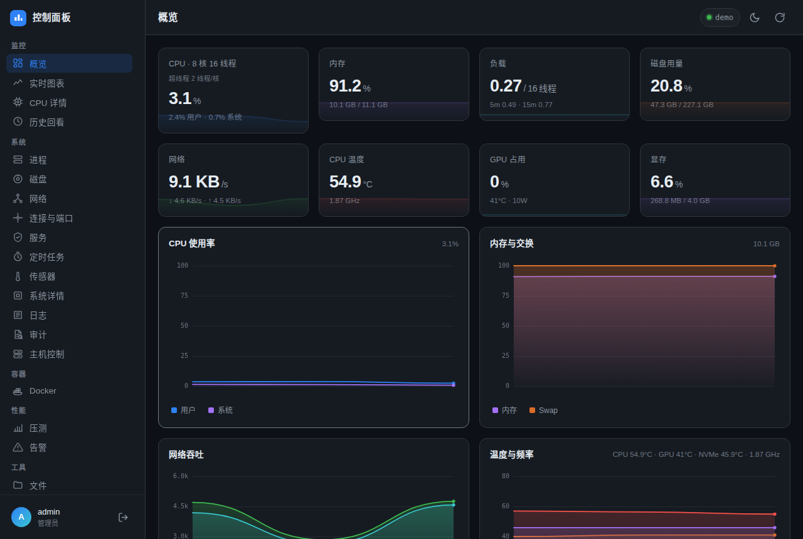 | 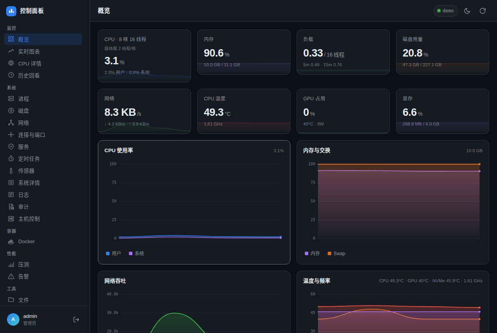 | 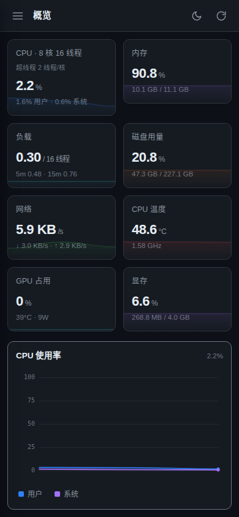 |

| 实时图表 | 历史回看 | 磁盘 |
|---|---|---|
| 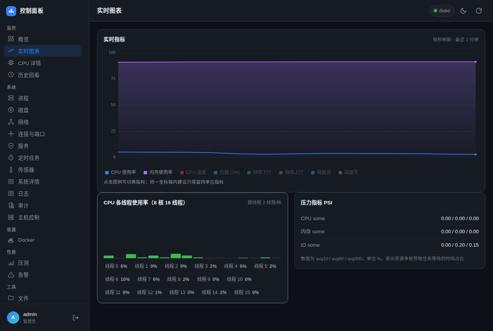 | 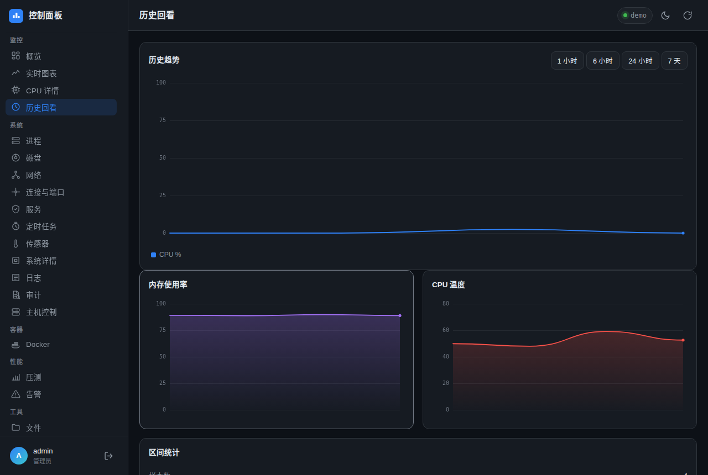 | 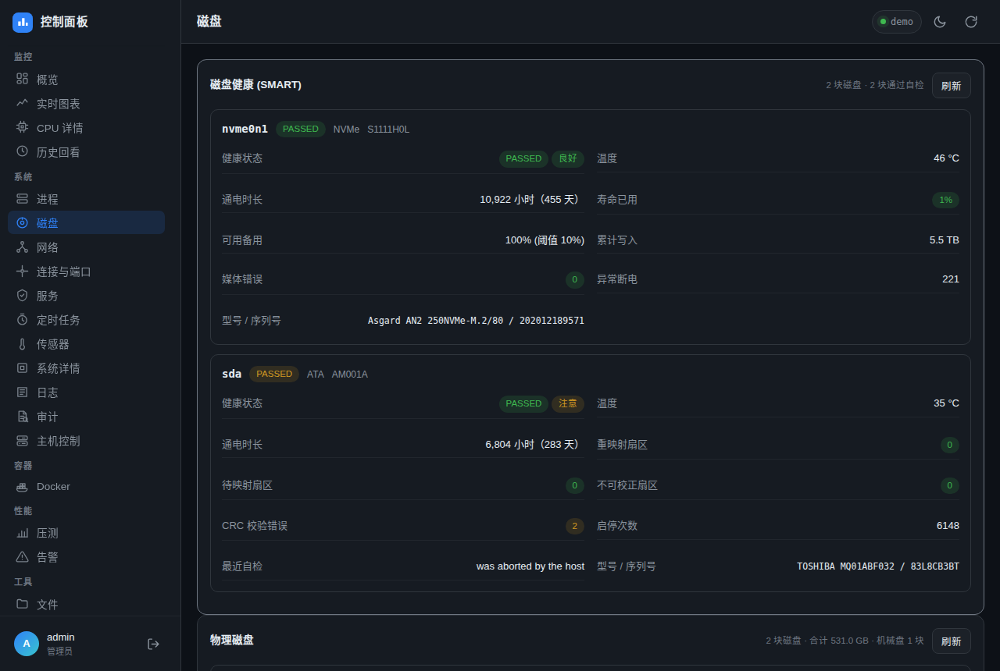 |

| 网络 | 性能压测 | 告警 |
|---|---|---|
| 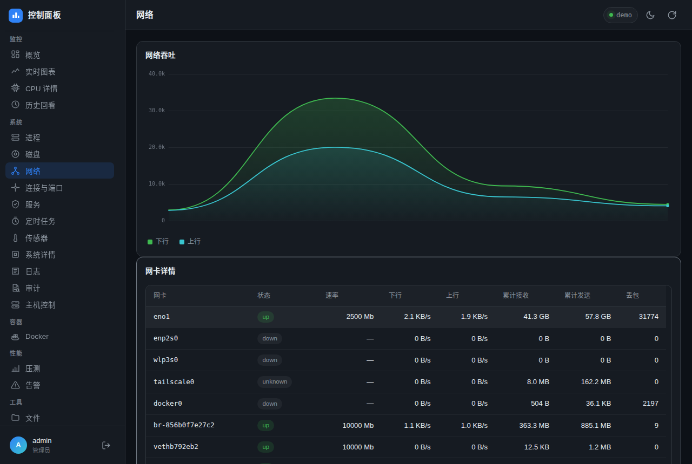 | 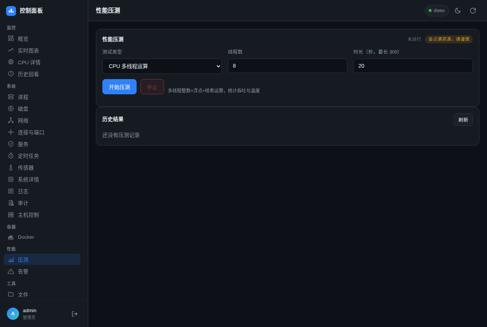 | 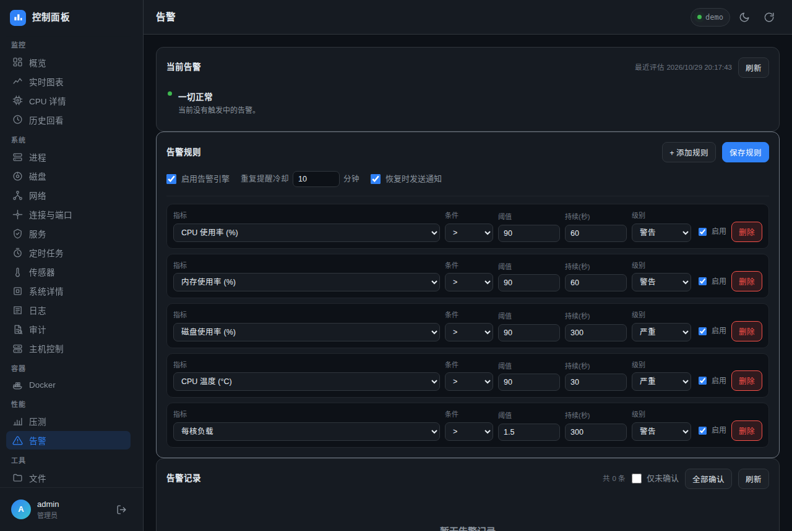 |

| 下载器（二维码分享） | 设置 | 登录 |
|---|---|---|
| 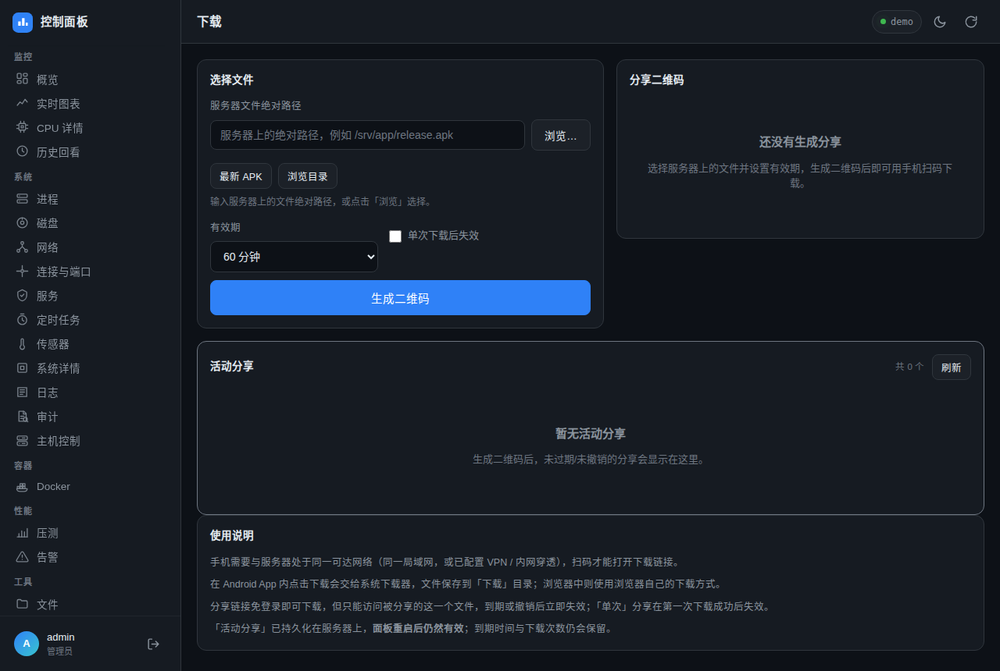 | 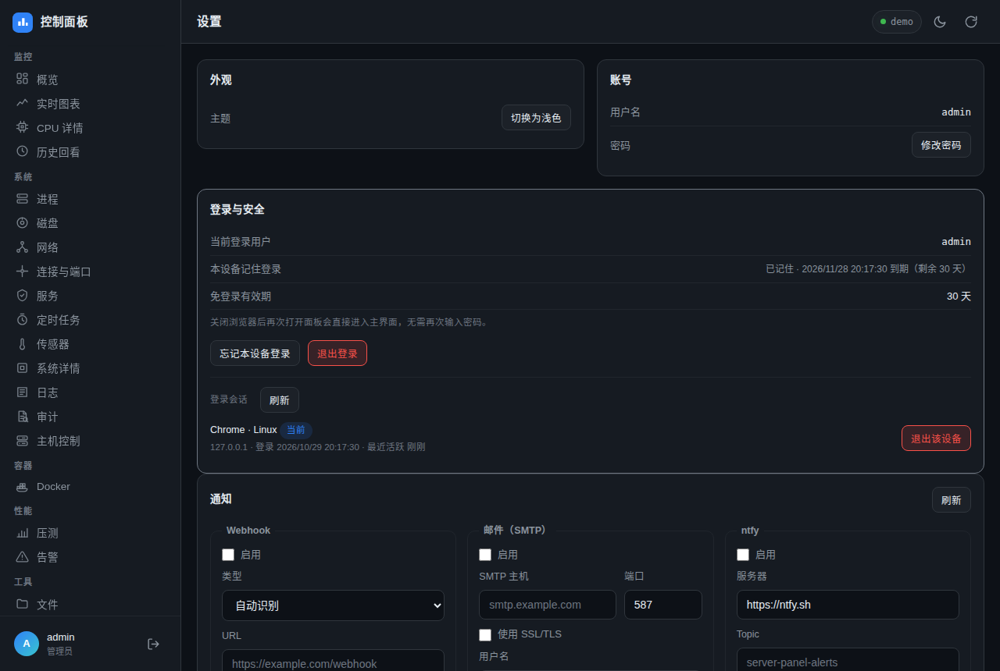 | 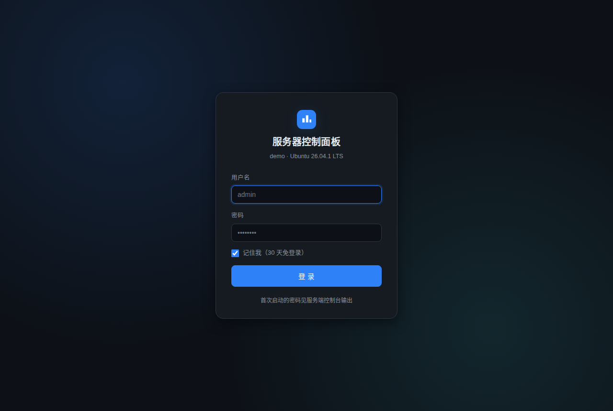 |

## 参与贡献 / 安全

- 贡献指南（设计约束、如何跑测试）：[CONTRIBUTING.md](CONTRIBUTING.md)
- 安全模型与部署建议（含高危开关、数据落盘、漏洞报告方式）：[SECURITY.md](SECURITY.md)

> 面板登录即拥有服务器操作权限（文件 / 终端 / 可选 root helper），请只在可信网络使用，
> 公网访问务必套 VPN 或反代 + HTTPS。

## 开源协议

本项目以 **GNU General Public License v3.0** 发布，详见 [LICENSE](LICENSE)。

- 你可以自由使用、修改、分发，衍生作品需同样以 GPL-3.0 开源
- 不提供任何担保（详见协议第 15、16 条）

## 文档说明

README 中的 `<面板IP>`、`<项目目录>`、`<tailnet主机名>` 等为占位符，按实际部署替换。
本机私有配置（IP、路径、DSH 地址等）可记录在 `docs/DEPLOY-local.md`（已加入 `.gitignore`，不会入库）。
